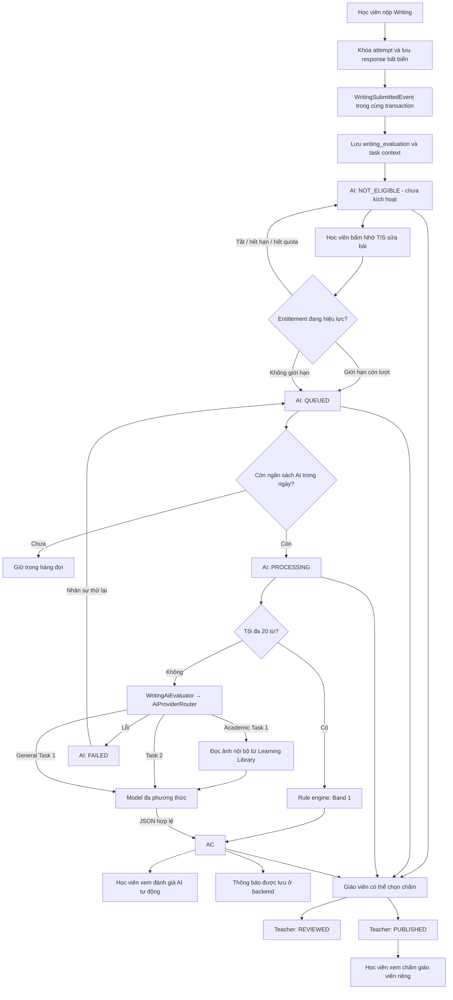
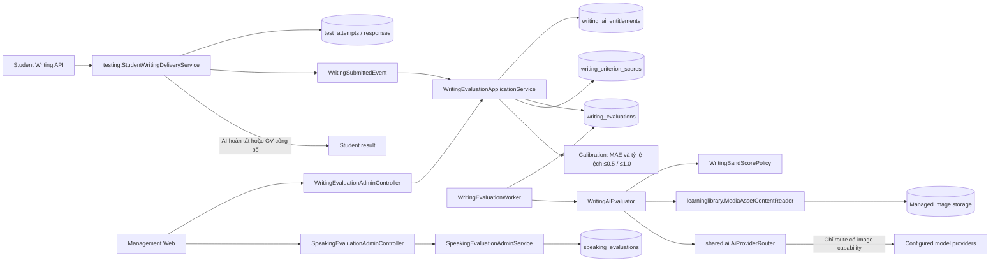

# Chấm Writing & Speaking — luồng xử lý và kiến trúc

## Quy tắc nghiệp vụ

- Mọi bài Writing đã nộp đều được lưu để giáo viên có thể chọn chấm.
- Nộp bài chỉ lưu bài, không tự dùng ngân sách AI. Học viên bấm “Nhờ TIS sửa bài” khi có entitlement đang hiệu lực và đủ quota cho các task chưa kích hoạt. Ba chế độ là `DISABLED`, `LIMITED` và `UNLIMITED`.
- `UNLIMITED` bỏ giới hạn theo học viên, nhưng vẫn chịu `WRITING_EVALUATION_DAILY_LIMIT` của toàn hệ thống.
- Đánh giá AI và chấm của giáo viên có trạng thái, điểm, tiêu chí và nhận xét riêng. AI hoàn tất thì học viên được xem tự động; chấm giáo viên chỉ hiện sau khi giáo viên công bố.
- Mỗi task dùng bốn tiêu chí IELTS có trọng số bằng nhau. Overall toàn bài được tính từ điểm thô của bốn tiêu chí theo công thức `(Task 1 + 2 × Task 2) / 3`, rồi làm tròn đến band `0.5` gần nhất.
- Bài có tối đa 20 từ được rule engine gán Band 1 cho cả bốn tiêu chí, không gọi model và không tốn quota nhà cung cấp.
- Academic Task 1 gửi ảnh đã quản lý trong Learning Library trực tiếp cho model đa phương thức. Ảnh ngoài hệ thống hoặc sai định dạng không được dùng để suy đoán.
- Gói thanh toán sau này có thể cập nhật cùng bảng entitlement với `source=PRO_SUBSCRIPTION`; giai đoạn hiện tại admin cấp thủ công với `source=MANUAL`.

## Luồng Writing

Việc nộp bài và tạo evaluation nằm trong cùng transaction. Kích hoạt AI là transaction riêng, khóa attempt và hàng `student_profiles` khi kiểm tra quota để các yêu cầu đồng thời không vượt giới hạn tháng. Bấm lại không xếp hàng hoặc trừ lượt lần hai. Tháng sử dụng được tính theo `ai_requested_at`, không phải ngày nộp bài. Worker dùng `SKIP LOCKED`, token ownership, advisory lock và `writing_ai_daily_usage` cho ngân sách ngày; mọi lần bắt đầu gọi provider, kể cả retry, đều chiếm một lượt. Lời gọi model không giữ database transaction mở.

## Trải nghiệm học viên

- Sau khi nộp có bốn tab: Bài viết của bạn, TIS sửa bài, Giáo viên chấm bài, Bài sample từ TIS.
- Khi TIS đang chấm, trang kết quả cập nhật mỗi 5 giây và gợi ý luyện Reading/Listening. Học viên có thể rời trang.
- Góc học tập truy vấn thông báo chưa đọc mỗi 10 giây. Thông báo hoàn thành TIS và công bố của giáo viên được lưu cùng transaction kết quả; chỉ chủ bài đọc và đánh dấu đã đọc được.
- Bài trong khóa hiển thị thông báo chờ giáo viên; bài tự do gợi ý tham gia khóa hoặc liên hệ giáo viên. Điểm nháp giáo viên không được gửi xuống client.
- Sample lấy từ nội dung đề đã xuất bản, được làm sạch HTML và chỉ trả trong kết quả được phép xem, không xuất hiện khi đang làm bài. Chưa có sample thì hiển thị trạng thái trống, không tự gọi AI để tạo.
- `POST /api/v1/student/writing/attempts/{attemptId}/ai-evaluation`: kiểm tra chủ bài, đã nộp, quyền truy cập khóa, chính sách mở kết quả và quota. Trả `queuedCount`.
- `GET /api/v1/student/notifications/writing`: thông báo Writing chưa đọc của học viên hiện tại; `POST /api/v1/student/notifications/writing/{id}/read`: đánh dấu đã đọc.
- Migration `V067` thêm thời điểm kích hoạt và backfill cho các bài đã vào luồng AI. Cần khởi động backend để Flyway áp dụng trước khi dùng API mới.

## Luồng chấm giáo viên

Giáo viên làm việc trên bản sao của bài nộp. `essay_text` là bản gốc bất biến; `teacher_edited_text` là bản sửa hiện tại; `teacher_published_text` là snapshot học viên đang xem; `teacher_annotations` và `teacher_published_annotations` lưu các nhận xét neo theo đoạn, loại thao tác (`COMMENT`, `REPLACE`, `HIGHLIGHT`), tiêu chí IELTS và mức độ. Mỗi lần lưu hoặc công bố tăng `teacher_revision`. Migration `V068` thêm lớp dữ liệu nháp và `V069` tách snapshot công bố.

Management Web cung cấp hai chế độ `Sửa bài` và `So sánh`. Giáo viên bôi chọn đoạn trong trình soạn thảo, gắn nhận xét, đề xuất thay thế hoặc đánh dấu, rồi nhập điểm bốn tiêu chí. Nội dung và annotation tự lưu qua `PUT /admin/writing-evaluations/{id}/draft`; `Lưu bản chấm` tạo trạng thái `REVIEWED`; `Công bố` tạo snapshot học viên được xem và phát thông báo. Bản đã công bố có thể tiếp tục chỉnh sửa thành bản nháp mới, nhưng chỉ lần công bố tiếp theo mới thay đổi dữ liệu học viên thấy.

Student API chỉ trả `teacher_edited_text` và `teacher_annotations` khi `teacher_status=PUBLISHED`. Vì vậy bản nháp và nội dung giáo viên đang sửa không thể xuất hiện ở tab học viên. Annotation giữ cả `selectedText` cùng chỉ số đoạn để giao diện có thể phục hồi vùng đánh dấu sau khi nội dung thay đổi.

## Kiến trúc

`status` của `writing_evaluations` là trạng thái AI: `NOT_ELIGIBLE`, `QUEUED`, `PROCESSING`, `AI_COMPLETED`, `FAILED`. `teacher_status` độc lập: `AVAILABLE`, `REVIEWED`, `PUBLISHED`. Các cột `ai_*` không bị ghi đè khi giáo viên chấm.

## Chuẩn chấm IELTS Writing

| Nội dung | Hiện trạng |
|---|---|
| Task Achievement cho Task 1 / Task Response cho Task 2 | Đã áp dụng theo loại task |
| Coherence and Cohesion | Đã áp dụng |
| Lexical Resource | Đã áp dụng |
| Grammatical Range and Accuracy | Đã áp dụng |
| Bốn tiêu chí có trọng số bằng nhau trong từng task | Đã cưỡng chế ở backend |
| Band descriptors chi tiết theo từng mức 0–9 | Prompt `writing-evaluator-v3`, rubric `ielts-writing-public-may-2023-v1` |
| Chấm Academic Task 1 dựa trên biểu đồ/hình | Đã gửi ảnh PNG/JPEG/WebP nội bộ cho provider hỗ trợ hình |
| Tính band toàn bài với Task 2 nặng gấp đôi Task 1 | Đã tính riêng cho AI và giáo viên khi đủ hai task |
| Các trường hợp đặc biệt như bài ≤20 từ | Rule engine Band 1, không gọi model |
| Kiểm chứng độ lệch so với giáo viên IELTS | Có dashboard số mẫu, MAE, tỷ lệ lệch không quá 0.5 và 1.0 band |

Điểm giáo viên của từng task được backend tính lại từ bốn tiêu chí; request có overall không khớp sẽ bị từ chối. Chỉ bài có AI hoàn tất và điểm giáo viên đã công bố mới tham gia số liệu calibration.

## Entitlement

`writing_ai_entitlements` lưu:

| Trường | Ý nghĩa |
|---|---|
| `enabled` | Bật quyền AI cho học viên |
| `unlimited` | Không kiểm tra quota cá nhân theo tháng |
| `monthly_limit` | Số task được chấm trong tháng khi dùng `LIMITED` |
| `active_from`, `expires_at` | Khoảng hiệu lực |
| `source` | `MANUAL` hiện tại, có thể dùng `PRO_SUBSCRIPTION` sau này |
| `granted_by`, `note` | Truy vết vận hành |

Một Writing Task đã được xếp hàng được tính là một lượt. Retry của cùng evaluation không tạo thêm lượt. Khi quota đã hết, bài vẫn có evaluation `NOT_ELIGIBLE` để giáo viên chấm.

## API quản trị

| Method | Endpoint dưới `/api/v1` | Quyền |
|---|---|---|
| GET | `/admin/writing-evaluations` | `assessment.grade` |
| GET | `/admin/writing-evaluations/{id}` | `assessment.grade` |
| GET | `/admin/writing-evaluations/calibration` | `assessment.grade` |
| PUT | `/admin/writing-evaluations/{id}/review` | `assessment.grade` |
| PUT | `/admin/writing-evaluations/{id}/draft` | `assessment.grade` |
| POST | `/admin/writing-evaluations/{id}/retry` | `assessment.grade` |
| GET | `/admin/writing-evaluations/entitlements` | `student.profile.update_academic` |
| PUT | `/admin/writing-evaluations/entitlements/{studentId}` | `student.profile.update_academic` |
| GET | `/admin/speaking-evaluations` | `assessment.grade` |
| GET | `/admin/speaking-evaluations/{id}` | `assessment.grade` |
| PUT | `/admin/speaking-evaluations/{id}/review` | `assessment.grade` |

Management Web dùng một workspace “Chấm Writing & Speaking” với tab Writing, Speaking và quyền AI Writing. Tab entitlement chỉ hiện cho admin và backend vẫn kiểm tra quyền độc lập.

## Cấu hình vận hành

- `WRITING_EVALUATION_ENABLED=true`: bật worker.
- `WRITING_EVALUATION_POLL_MILLIS=10000`: khoảng nghỉ giữa các lượt lấy job.
- `WRITING_EVALUATION_DAILY_LIMIT=5`: số job AI tối đa được bắt đầu mỗi ngày trên toàn hệ thống. Đặt `0` để tạm dừng chi phí mà không mất queue.

Các migration `V062`–`V065` thêm trạng thái không đủ điều kiện, entitlement, trạng thái giáo viên độc lập, dữ liệu chấm Speaking và ledger ngân sách AI theo ngày. Khi triển khai, dừng worker cũ trước khi chạy migration; rollback bằng forward migration và không xóa bảng entitlement hoặc các cột kết quả đã phát sinh.

## Giới hạn hiện tại

1. Entitlement mới áp dụng cho Writing. Speaking đang dùng luồng AI có sẵn và chưa dùng quota chung.
2. Global limit là ngân sách số lượt, chưa phải ngân sách token hoặc tiền thực tế.
3. Academic Task 1 cần ít nhất một provider đa phương thức đã cấu hình; router tự bỏ qua provider chỉ hỗ trợ văn bản.
4. Danh sách quản trị giới hạn 200 evaluation và entitlement giới hạn 500 học viên; bổ sung phân trang khi quy mô vượt mức này.
5. Chưa tích hợp Python service. Sau này có thể thay adapter AI mà giữ nguyên entitlement, queue và contract kết quả.
